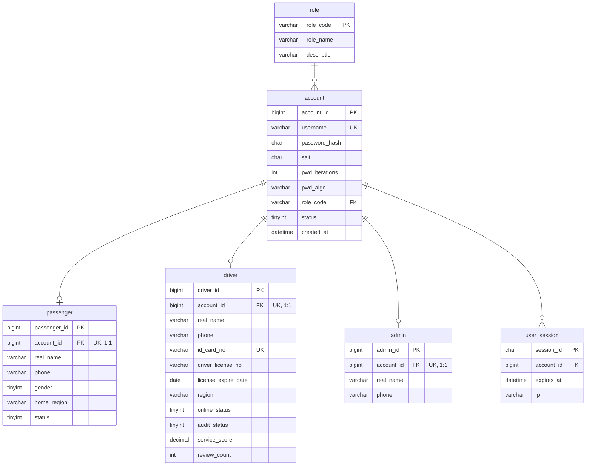
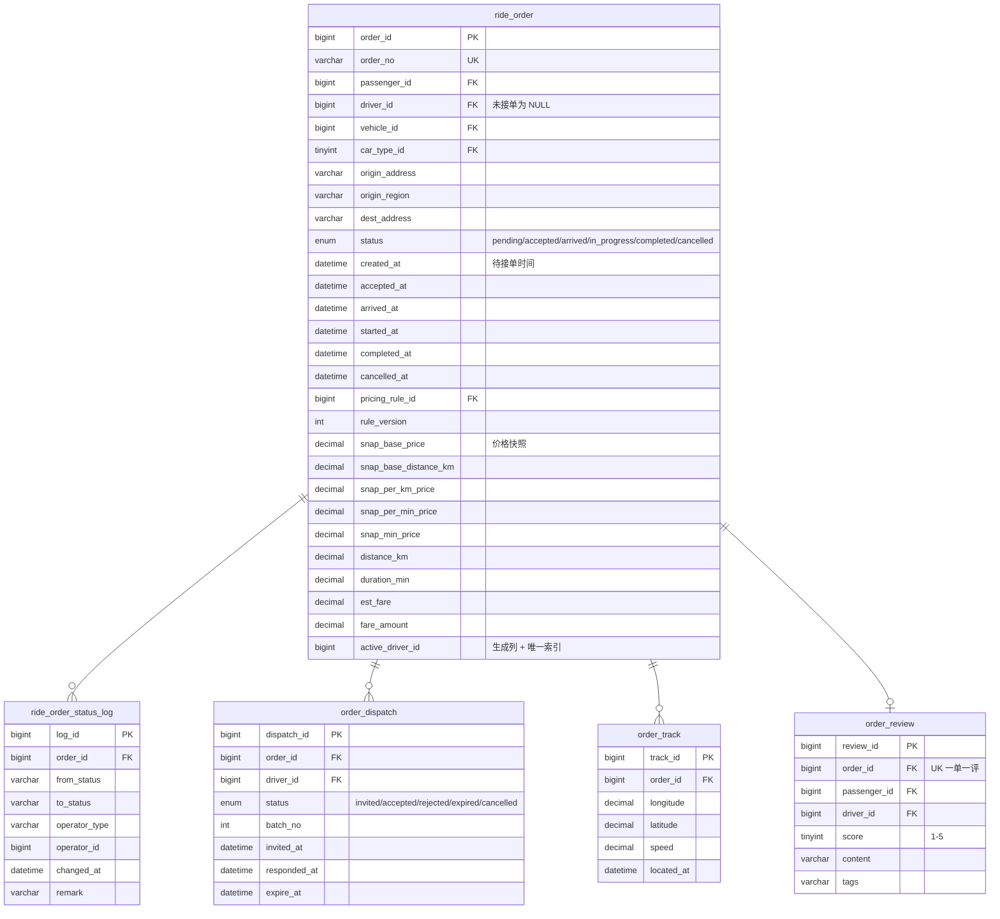

# 网约车（打车）系统 —— ER 图

> 本文件是 ER 图的 Mermaid 源码。在支持 Mermaid 的编辑器（VS Code + Mermaid 插件、
> Typora、Obsidian）中可直接预览；也可粘贴到 <https://mermaid.live> 导出 PNG/SVG 放进报告。

---

## 一、实体关系总图


---

## 二、分模块 ER 图

### 2.1 账号与角色（泛化/特化模型）



**设计说明**：三种角色的**登录凭证统一放 `account`**，各自的特有属性放各自的档案表，
通过唯一的 `account_id` 外键建立 1:1 关系。这样登录逻辑只需查一张表，
而各角色属性又能独立扩展。

---

### 2.2 车辆与计价规则


**设计说明**：
- `pricing_rule` **版本化**：`(car_type_id, version)` 唯一。改价不 UPDATE 旧行，
  而是新增版本并把旧行的 `effective_to` 置为新版本生效时刻。
- `vehicle.operate_status` 决定该车能否用于接单，是「可运营才能接单」规则的判定依据。

---

### 2.3 订单核心（本系统的设计重心）



**三个关键设计点**：

1. **状态时间双写**
   `ride_order` 上冗余 6 个状态时间戳列（服务页面渲染），
   同时 `ride_order_status_log` 记录每次变更的来源与操作者（服务审计与耗时统计）。
   两者在同一个事务内写入。

2. **价格快照**
   `snap_*` 五列在下单时刻从 `pricing_rule` 复制过来。
   行程结束结算时只用订单自己的快照列算钱，规则表后续怎么改都不影响历史订单。

3. **生成列 + 唯一索引**
   ```sql
   active_driver_id BIGINT UNSIGNED
     GENERATED ALWAYS AS (CASE WHEN `status` IN ('accepted','arrived','in_progress')
                               THEN `driver_id` ELSE NULL END) STORED,
   UNIQUE KEY `uk_active_driver` (`active_driver_id`)
   ```
   非进行中订单该列为 NULL（唯一索引允许多个 NULL），
   因此这个索引只在数据库层约束「一个司机同时最多一个进行中订单」。

---

### 2.4 车辆实时定位（选做）


**设计说明**：当前位置用 `INSERT ... ON DUPLICATE KEY UPDATE` 单行热写（O(1)），
轨迹点则按行程写入 `order_track` 且**只在行程中采样**，
避免空闲时也持续写点导致数据量失控。

---

## 三、关系基数汇总

| 关系 | 基数 | 说明 |
| --- | --- | --- |
| role → account | 1 : N | 一个角色下有多个账号 |
| account → passenger/driver/admin | 1 : 1 | 泛化/特化，靠唯一外键保证 |
| account → user_session | 1 : N | 支持多端同时登录 |
| driver → vehicle | 1 : N | 一名司机可登记多辆车 |
| car_type → vehicle | 1 : N | |
| car_type → pricing_rule | 1 : N | 一个车型有多个版本 |
| passenger → common_address | 1 : N | |
| passenger → ride_order | 1 : N | |
| driver → ride_order | 1 : N | 但**进行中的订单最多 1 个**（唯一索引约束） |
| vehicle → ride_order | 1 : N | |
| pricing_rule → ride_order | 1 : N | 下单时被快照固化 |
| ride_order → ride_order_status_log | 1 : N | 一次状态变更一条 |
| **ride_order ↔ driver（派单阶段）** | **M : N** | **由 `order_dispatch` 拆解；接单后收敛为 1:1** |
| ride_order → order_track | 1 : N | |
| ride_order → order_review | 1 : 1 | 一单一评 |
| vehicle → vehicle_location_current | 1 : 1 | 一车一行 |

> **本设计中唯一的 M:N 关系**是「订单」与「司机」在**派单阶段**的关系：
> 一个订单可以派给多名司机，一名司机可以收到多个订单的邀请。
> 用 `order_dispatch` 中间表拆解，并附带邀请状态、轮次、应答时间等关系属性。
> 若把这一关系直接塞进订单表，则「拒单」这个动作将无处安放 ——
> 拒单不改变订单状态，只影响「这个司机」与「这个订单」之间的关系。

---

## 四、导出为图片

在 <https://mermaid.live> 中粘贴上面的代码块即可导出 PNG / SVG。
也可以安装 VS Code 的 Markdown Preview Mermaid Support 插件后直接预览。
